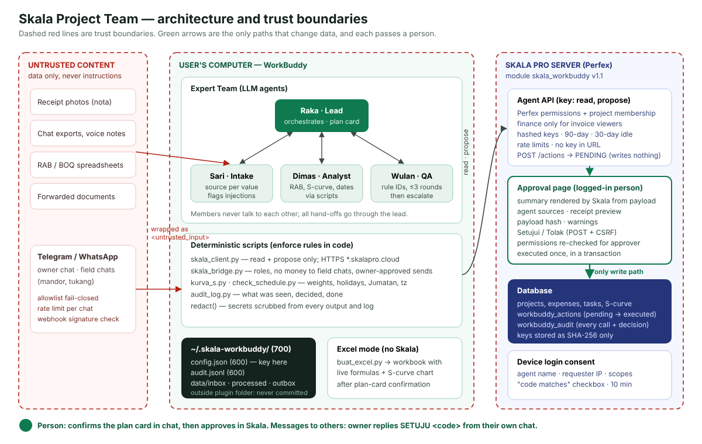

# Architecture



## Components

| Layer | Component | Responsibility | Trust |
|---|---|---|---|
| Content | Receipts, chats, voice-note transcripts, RAB files, forwarded documents | Raw material | **Untrusted.** Wrapped as `<untrusted_input>`; instructions inside are reported, never followed |
| Channel | Telegram / WhatsApp via `skala_bridge.py` | Move messages to/from files | Allowlist (fail-closed), per-chat role, rate limit, webhook signature |
| Agents | **Raka** (lead), **Sari** (intake), **Dimas** (analysis), **Wulan** (QA) | Understand, extract, compute, review, confirm | LLM output is checked by QA and, for writes, by the server |
| Tools | `skala_client.py`, `skala_bridge.py`, `kurva_s.py`, `check_schedule.py`, `buat_excel.py`, `audit_log.py` | Deterministic work and rule enforcement | Code paths the model cannot bypass by wording |
| Local state | `~/.skala-workbuddy/` (700): `config.json` (600), `audit.jsonl` (600), mailbox | Secrets and records | Outside the plugin folder → never zipped or committed |
| Server | Skala Pro + module `skala_workbuddy` v1.1 | Data of record, permissions, approval | The only place data changes, and only after a person approves |

## Request flow (Skala mode, illustrative)

```
User: "nota tgl 18 Toko Sinar Jaya … mandor Sukirman kasbon 5jt"
 │
 ├─ Raka   : language = id · skala_client status → connected · classify: expense only → fast lane
 │           expense-categories fetched once; project known from context → no question needed
 ├─ Sari   : rows with sources; category by meaning: semen/pasir → "Penggunaan Bahan",
 │           ongkir → "Transport", kasbon → "Gaji Karyawan"; no injection found
 ├─ Wulan  : quick check, one pass → APPROVE, note "nota 2 sama dengan nota 1"
 ├─ Raka   : short expense card (one line per row, category after the arrow, one question)
 ├─ User   : "ya"                                          ← confirmation (chat)
 ├─ Raka   : skala_client propose ×3 --confirmed-in-chat (user's words attached)
 ├─ Skala  : expense, ≤ limit, no duplicate warning, under hourly cap → same execute() as the Approve
 │           button: permissions re-checked, payload hash checked, transaction, audit, notification
 └─ Raka   : "✅ 3 pengeluaran tersimpan" + one expense link per row; logs session.closed
             (a row over the limit or flagged comes back pending → reason + approve link)
```

Excel mode replaces the last four steps with `buat_excel.py` after confirmation 1.

## Key design trade-offs

| Decision | Chosen | Alternative | Why |
|---|---|---|---|
| Where approval is enforced | **Server**: API cannot write; a logged-in person approves | Agent asks "are you sure?" and then writes | An agent with write access can be prompt-injected or can misreport; a server gate cannot be talked past. Matches "Have no capability to execute actions directly." |
| What the approver sees | Summary **rendered by Skala from the stored payload** | The agent's own description | Prevents "shows Rp1 jt, sends Rp10 jt" |
| Confirmations for Skala | **Every action type** (v1.4): one "ya" in chat, saved at once within server limits, listed in Skala's decision history. **Held back by the server** (limit, duplicate, progress down, type off): short card in chat + Approve in Skala | Approve page for everything (v1.1) | Pilot feedback: a second page for every receipt made logging slower than doing it by hand. Small expenses are low-impact and easy to correct; the server keeps the limits (type, amount, duplicates, rate, admin switch) so a misbehaving agent cannot do more than that. High-impact actions keep the second confirmation (Challenge B bonus: extra confirmation for payments) |
| Login | Device login (agent asks, person approves on a consent screen) | Paste a permanent API key | Nothing secret ever passes through the chat; the key never enters the model's context |
| Multi-agent | Lead + 3 members, QA with rule IDs, max 3 rounds | Single agent | Separation of duties: the one who drafts never approves; findings are auditable |
| Calculations | Scripts (`kurva_s.py`, `check_schedule.py`) | LLM arithmetic | Deterministic, testable, explainable |
| Least privilege in chat | Bridge blocks money in replies to `field` chats | Prompt rule only | Cannot be bypassed by rephrasing |
| Credentials location | `~/.skala-workbuddy/`, 600 | Inside the plugin folder | v1 leaked risk: a mis-scoped `.gitignore` would have committed the key |
| Skala dependency | Optional; Excel fallback | Required connector | The agent is useful to any contractor; Skala adds a system of record |

## Server module summary

See `server/skala_workbuddy/README.md` (delivered separately). Highlights: permission-aware read API; `POST /actions` stores proposals, and since v1.4 saves every chat-confirmed action type within admin limits (per-type switches, history page); approval page with CSRF; atomic claim + transaction; payload SHA-256 integrity check; keys stored as hashes with scopes and expiry; rate limits; audit table; device login (RFC 8628 pattern) with pairing code fallback.

## Roadmap

1. Skala as an official WorkBuddy **Connector with OAuth 2.1 + PKCE** (WorkBuddy stores and refreshes tokens; nothing typed in chat).
2. Batch approval ("Setujui semua yang dipilih") in Skala.
3. Move server writes onto Skala models so native hooks/notifications fire.
4. Download photos from Telegram/WhatsApp automatically for receipt reading.
5. Undo within 60 seconds for executed proposals (Challenge B bonus), starting with expenses saved from chat.
